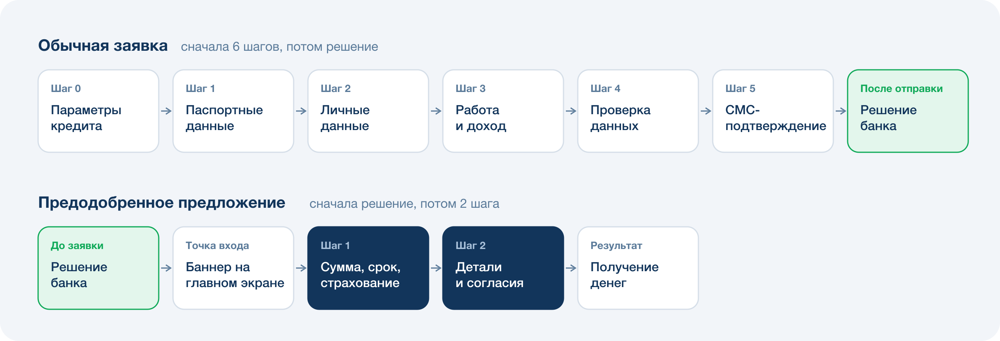

## Контекст

Предодобренные предложения уже запускались в нативном Android-приложении, но через 3 месяца их остановили: продукт оказался нерентабельным. Я пришёл в команду после остановки и решил перезапустить предложения в Android и одновременно запустить их в PWA. Через PWA банк обслуживает большую часть пользователей iOS, около 10% пользователей Android и desktop-версию (ещё 3% клиентов). Направления: потребительский кредит, кредитная карта, рефинансирование.

**Ограничения:** регуляторные требования, требования риск-менеджмента, ограниченная база клиентов с полным набором данных для расчёта предложения.

## Проблема

Клиенты PWA, даже те, о ком банк уже всё знает, проходили обычную кредитную заявку: **6 шагов и около 30 полей**.

- Конверсия от старта обычной заявки до выдачи: **4,1%**
- Бросают заявку, не отправив: **75%**
- Получают отказ из отправленных: **75%**
- Не оформляют кредит из одобренных: **33%**

Банк тратил ресурс клиента на сбор данных, которые у него уже были, и терял большую часть людей ещё до решения.

Короткий путь к кредиту уже был, но только в Android, и там он не окупился. Новая функциональность появлялась только у тех, кто обновил приложение, а на момент запуска обновились всего 10–15% пользователей. Охвата не хватило, чтобы продукт стал рентабельным.

## Задача

Запрос кредитного бизнеса: растить продажи кредитов в цифровых каналах без роста бюджета на привлечение.

## Discovery

Рассмотрел три направления, которые уже доказали эффективность на рынке:

1. Сокращение шагов обычной заявки за счёт автозаполнения данными Госуслуг
2. Доработка рисковой модели
3. Отдельное предодобренное предложение для клиентов

Выбрал предодобренное предложение: максимальный эффект на уже известный сегмент при минимальном риске и стоимости. Механика была проверена в Android, а в PWA у неё нет главной проблемы Android-версии: PWA обновляется у всех клиентов одновременно, поэтому новая функциональность сразу доступна всей аудитории. Возвращать предложения в Android тоже имело смысл: пока мы делали PWA-версию, доля пользователей с обновлённым приложением росла. Сокращение шагов обычной заявки через Госуслуги — следующий этап, сейчас в работе.

Для старта выделил **«бесплатный» сегмент**: около 12% пользователей, по которым у банка есть все параметры для расчёта предложения и все нужные согласия.

## Решение

### Этап 1. Запуск в PWA

Новый флоу:

1. Банк заранее рассчитывает предложение по тем же рисковым моделям, что и для обычной заявки: решение принято до того, как клиент начал оформление
2. Клиент видит персональное предложение в баннере на главном экране
3. Предодобренная заявка, шаг 1: сумма, срок, вариант страхования
4. Предодобренная заявка, шаг 2: проверка деталей и согласия
5. Получение денег

Повторного запроса в риски нет: банк заранее рассчитывает предложение на все сочетания суммы, срока и страхования, которые клиент может выбрать в заявке.

Что я делал:

- вынес точку входа на главный экран. В Android предложение показывалось только в уведомлениях, а туда заходят не все клиенты. Сделал баннер на главном экране во всех платформах (iOS, Android и desktop), и путь до заявки стал короче;
- провёл A/B-тест баннеров, а затем раскатил на весь сегмент.

### Этап 2. Расширение базы через Госуслуги (ЕСИА)

Данные Госуслуг в банке уже были, но использовались только внутри кредитной заявки. Чтобы использовать их в предложениях:

- запустил переиспользование данных ЕСИА в скоринге предложений: определил скоуп и формат реализации — какие системы участвуют и как обмениваются данными (это была основная сложность проекта);
- добавил отдельную точку сбора данных Госуслуг вне кредитной заявки;
- провёл согласование с юристами и ИБ.

## Результат

Предодобренная заявка — 2 шага вместо 6 шагов и ~30 полей обычной. До выдачи доходят **15,1%** начавших её клиентов, по обычной заявке — **4,1%**. Выдачи кредитов в цифровых каналах выросли на **10%**. Затраты на привлечение не выросли, потому что коммуникации идут только внутри приложения. Риск-метрики не изменились: решения принимают те же рисковые модели.

**Прогноз по ЕСИА:** +20% к базе предложений, +1,5% к выдачам.

**Дальше:** новые каналы коммуникаций, использование предложений в офисах, расширение применения данных Госуслуг.

## Выводы

- Раньше большие встречи, где все стороны должны «договориться», казались мне потерей времени. Пока согласовывал вопросы с каждым департаментом по очереди, задача просто перекидывалась между ними, и каждая итерация съедала время. Одна общая встреча, после которой есть решение, оказалась быстрее.
- Подсвечивать выгоду для клиента работает хорошо, но, на удивление, «нужно» работает ещё лучше. Клиенты охотнее дают данные, когда шаг подан как обязательный, даже если нужен он банку, а не им.
